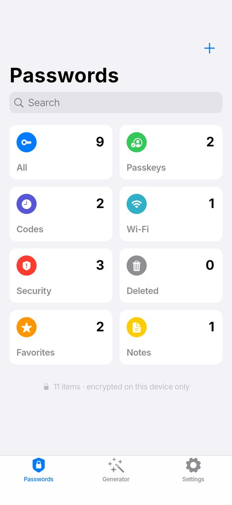
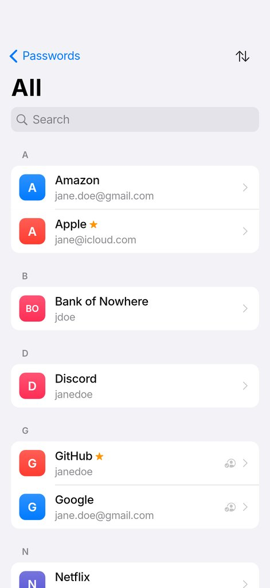
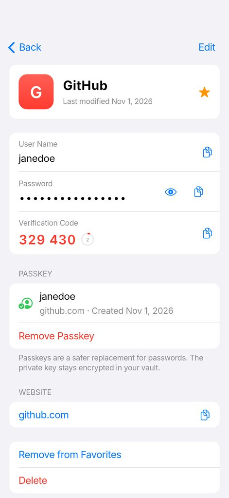
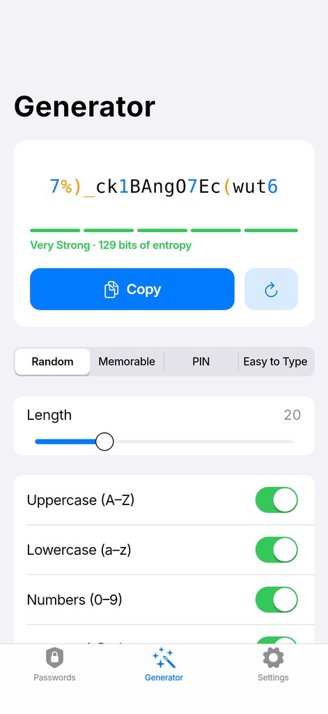
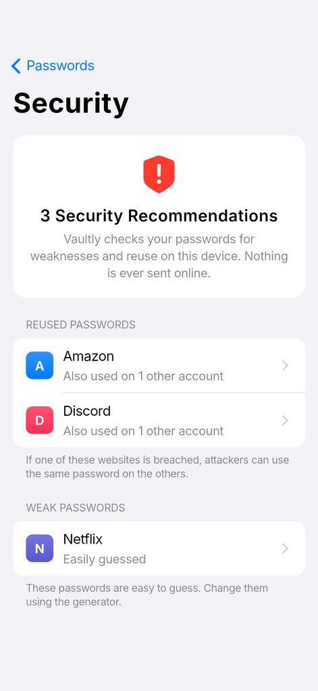
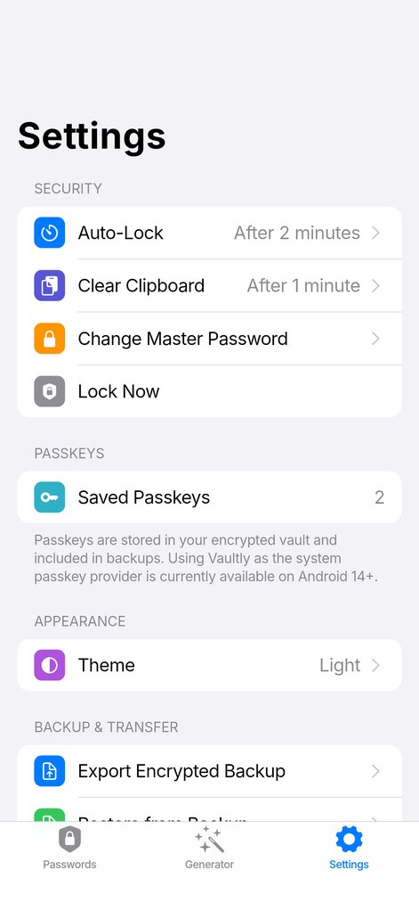
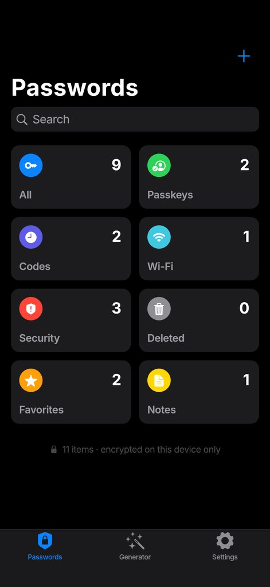
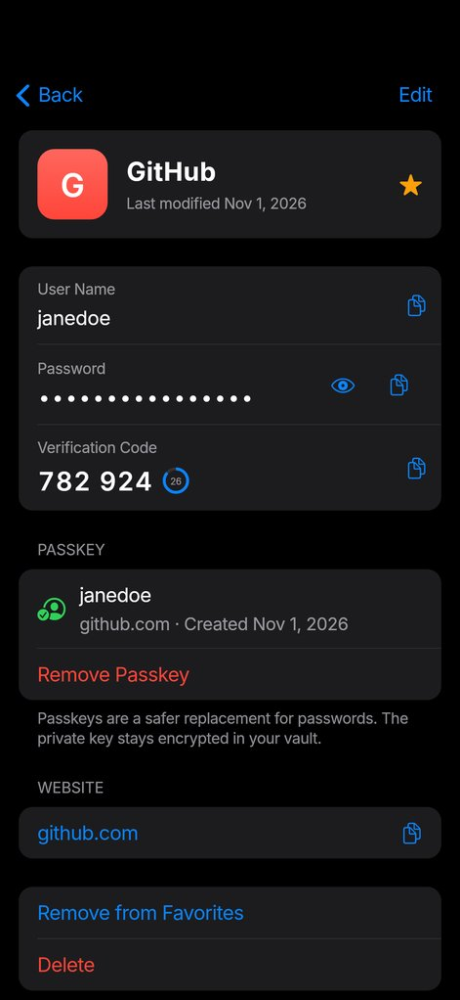
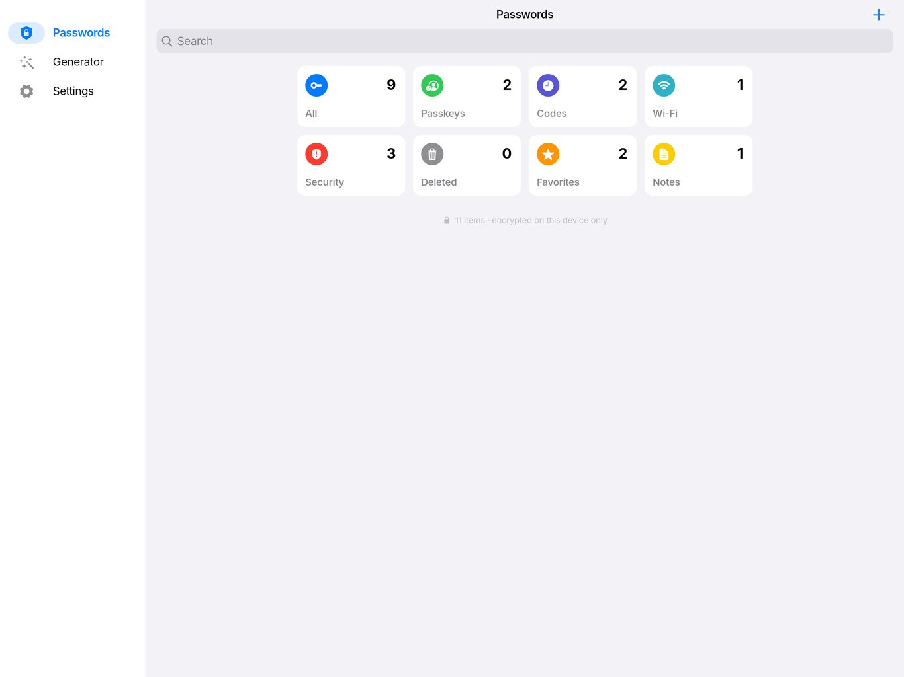

# Vaultly 🔐

*A 100% offline, encrypted password & passkey manager — designed like Apple's Passwords app, built with Flutter.*

Vaultly stores your passwords, passkeys, two-factor codes, Wi-Fi networks and secure notes **only on your device**.
No account. No cloud. No network permission. Just strong encryption and full control.

---

## ✨ Features

| | |
|---|---|
| **Fully offline** | No account, no sync, no telemetry. The Android release build has no `INTERNET` permission, icons are drawn locally (no favicon downloads), and cloud backup of app data is disabled. |
| **Strong encryption** | Argon2id key derivation + AES-256-GCM authenticated encryption. See [Security design](#-security-design). |
| **Apple Passwords–style UI** | Mobile-first: large-title navigation, search, category tiles (All, Passkeys, Codes, Wi-Fi, Security, Deleted, Favorites, Notes), inset grouped lists, light & dark mode. Tablet/desktop get a sidebar layout. |
| **Password generator** | Random (4–64 chars, character classes, avoid ambiguous), **Memorable** passphrases from the EFF 7,776-word list, **PIN**, and Apple-style **Easy to Type** (`kibvoq-7ruxzy-Wefnyp`). Shows entropy & strength, keeps an encrypted history of copied passwords (like LastPass). |
| **Passkeys** | Built-in WebAuthn authenticator (ES256 / P-256). On **Android 14+** Vaultly is a system passkey provider: apps and browsers can create and use passkeys stored in your vault. |
| **Verification codes** | TOTP (RFC 6238; SHA-1/256/512, 6–10 digits) from a setup key or `otpauth://` link, generated offline. |
| **Security recommendations** | Flags weak and reused passwords, entirely on-device. |
| **Biometric unlock** | Face ID / Touch ID / fingerprint / Windows Hello. The vault key is bound to the OS keystore; the master password is never stored. |
| **Recently Deleted** | Deleted items are kept for 30 days, then purged. |
| **Password history** | Previous passwords of each item are kept (last 10). |
| **Import & export** | Encrypted `.vaultly` backups; CSV import from Apple Passwords, Chrome/Edge/Brave, Firefox, Safari, LastPass, Bitwarden, 1Password, Dashlane, Proton Pass; CSV export; import of old Vaultly 1.x backups. |
| **Privacy protections** | Auto-lock (after inactivity or in the background), clipboard auto-clear (marked *sensitive* on Android 13+), content hidden in the app switcher, `FLAG_SECURE` on Android. |

### Screenshots

<p>
   
</p>
<p>
   
</p>


Rendered from the real widgets (`test/screenshots_test.dart`):

```bash
VAULTLY_SCREENSHOTS="$PWD/build/screenshots" flutter test --update-goldens test/screenshots_test.dart
```

---

## 🔐 Security design

```text
master password ──Argon2id(salt, 46 MiB, t=2)──▶ KEK ─┐
                                                      │ AES-256-GCM
                     random 256-bit vault key ◀───────┘   (keyBox)
                              │ AES-256-GCM, fresh 96-bit nonce per save
                              ▼
                     encrypted vault JSON (dataBox)  →  vault.vaultly
```

- **Master password** is never stored. A wrong password is detected by the GCM tag on the wrapped key.
- **Vault key** is random, so changing the master password only re-wraps 32 bytes, and biometric unlock can keep the vault key (never the password) in the platform keystore:
  - iOS: Keychain, `biometryCurrentSet` + this-device-only (re-enrolling Face ID invalidates it).
  - Android: Keystore key requiring Class 3 biometrics.
  - macOS / Windows: Keychain / Credential Locker behind a Touch ID / Windows Hello prompt.
- **Everything** (titles, usernames, URLs, notes, passkey private keys, generator history) is inside the encrypted payload. Only the KDF parameters are stored in plaintext.
- **Associated data** binds each box to its purpose (`vault` vs `backup`, `key` vs `data`), so a backup can't be swapped in as the live vault.
- **Atomic writes** (temp file → rename, previous version kept as `.bak`) protect against corruption.
- **KDF parameters** are range-checked on load, so a tampered header can't force an absurdly weak or huge derivation.
- Argon2id runs on a background isolate, so the UI never freezes.

Crypto comes from [pointycastle](https://pub.dev/packages/pointycastle). Tests check Argon2id against the reference implementation's vector, AES-GCM against the NIST/McGrew–Viega vectors, and TOTP against the RFC 6238 vectors.

> **Your master password cannot be recovered.** If you forget it, the vault is lost. Export encrypted backups regularly.

---

## 🗝 Passkeys

`lib/core/passkey/` implements a software WebAuthn authenticator: P-256 key generation, COSE keys, CBOR attestation objects (`none` attestation), authenticator data (UP/UV/BE flags), and DER ES256 signatures. Tests verify the signatures.

| Platform | Status |
|---|---|
| **Android 14+** | System passkey provider via Credential Manager (`VaultlyCredentialProviderService` + `PasskeyActivity`). Enable it in *Settings → Passwords, passkeys & accounts*, or from Vaultly's Settings → *Use Vaultly for Passkeys*. While the vault is locked, the system sheet shows **Unlock Vaultly**. Only passkey *metadata* is shared with the service, in memory, and only while unlocked. |
| **iOS / macOS** | Passkeys are stored, viewed, backed up and restored with the vault. Acting as the *system* passkey provider requires an AuthenticationServices Credential Provider app extension (Xcode target + App Group). This is planned and is the next native piece. |
| Windows / Linux | Stored and backed up; no OS passkey-provider API is available to third-party apps. |

---

## 🧱 Architecture

```
lib/
├── core/                 Pure Dart, no Flutter — fully unit tested
│   ├── crypto/           Argon2id KDF, AES-256-GCM, secure random, encodings
│   ├── generator/        Password / passphrase / PIN generator, EFF wordlist
│   ├── otp/              TOTP / HOTP
│   ├── passkey/          WebAuthn authenticator + CBOR
│   ├── security/         Strength estimator, weak/reused audit
│   └── import_export/    CSV (RFC 4180) import/export, Vaultly 1.x backups
├── data/                 Vault model, encrypted envelope, storage, VaultService,
│                         biometrics, settings, native bridge
├── state/                Riverpod controllers (vault, settings, categories)
└── ui/                   Screens, iOS design system (theme, inset lists, toasts)

android/…/kotlin/          MainActivity (FLAG_SECURE, sensitive clipboard),
                           Credential Manager passkey provider
```

**Why Flutter and not separate native apps?** One audited codebase for crypto, vault format and UI on five platforms, with small native modules only where the OS requires it (passkey provider, secure window, clipboard). Native code calls into the same tested Dart passkey engine, so there is one implementation of the security-critical logic.

---

## 🚀 Getting started

Prerequisites: Flutter 3.32+ (Dart 3.8+); Xcode for iOS/macOS; Android Studio / SDK 34+ for Android.

```bash
flutter pub get
flutter run
```

Run the tests:

```bash
flutter analyze
flutter test
```

Supported platforms: **Android, iOS, macOS, Windows, Linux**. (Web was removed: a browser can't provide the private, offline file storage and keystore Vaultly relies on.)

Before publishing, change the application ID / bundle identifier (`com.example.vaultly`) and configure release signing.

---

## 🔄 Upgrading from Vaultly 1.x

Version 2 uses a new, much stronger vault format (1.x used unsalted SHA-256 with a fixed IV and synced to Supabase). To move your data:

1. In Vaultly 1.x: **Settings → Export Vault**.
2. In Vaultly 2: **Settings → Restore from Backup** and pick that file, then enter its backup password.

---

## 🤝 Contributing

See [CONTRIBUTING.md](CONTRIBUTING.md). Please include tests for changes in `lib/core` and `lib/data`.

## 📜 License

CC BY-NC 4.0 — see [LICENSE](LICENSE).
The EFF Large Wordlist is © Electronic Frontier Foundation, CC BY 3.0 US.

---

Made with ❤️ by AshkanWatson and the Vaultly community.
